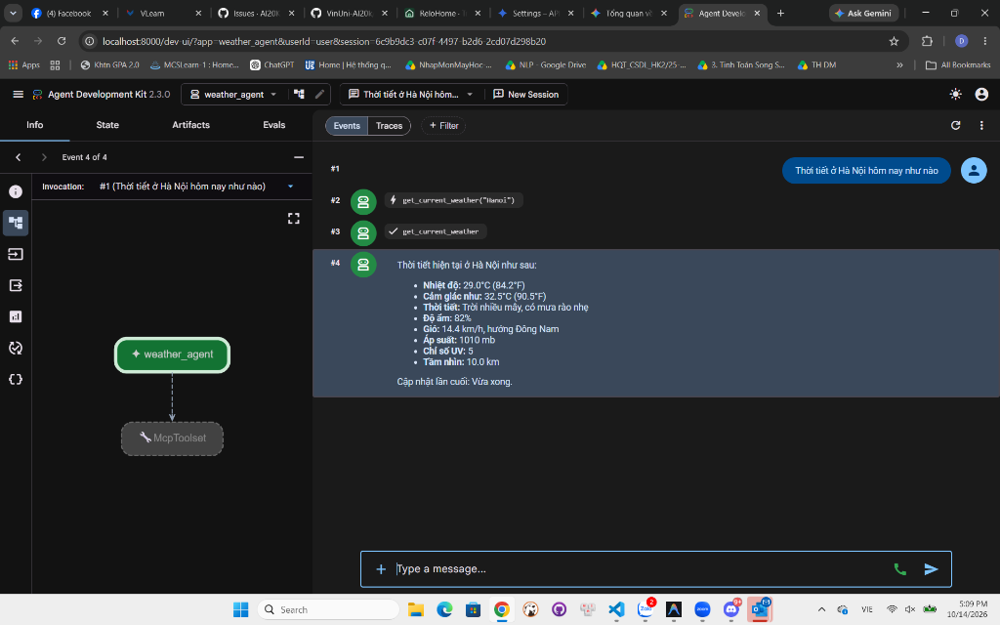

# BÁO CÁO THỰC HÀNH BÀI LAB: MCP & TOOLS INTEGRATION

**Học viên:** Mai Quang Dũng  
**Mã học viên:** 2A202602966  
**Chủ đề:** Phân biệt Function Calling & Model Context Protocol (MCP) — Xây dựng Weather Agent với Google ADK và FastMCP Server  
**Repo:** [K4-DAY26-MaiQuangDung-2A202602966](https://github.com/DungMQ/K4-DAY26-MaiQuangDung-2A202602966)

---

## I. MỤC TIÊU BÀI LAB

1. **Hiểu bản chất:** Phân biệt rõ sự khác nhau giữa **Function Calling** (năng lực mô hình) và **MCP** (chuẩn giao thức kết nối mở giữa AI Client và Tool Server).
2. **Khai báo & Tự động hóa Schema:** So sánh việc viết schema thủ công (Function Calling) với việc tự động sinh schema từ mã nguồn qua decorator `@mcp.tool()`.
3. **Kiến trúc MCP Production:** Nắm vững và thực hành 3 tiêu chuẩn sản xuất:
   - *Security / Authentication:* Bảo vệ Server qua Streamable HTTP và xác thực Bearer Token.
   - *Tool Registry & Dynamic Discovery:* Khám phá và lựa chọn công cụ linh hoạt theo tags và Semantic Versioning.
   - *Versioning & Backward Compatibility:* Duy trì song song phiên bản cũ (v1) và mới (v2) cùng siêu dữ liệu `server://info`.
4. **Ứng dụng thực chiến:** Xây dựng hệ thống hoàn chỉnh kết hợp **Google Agent Development Kit (ADK)** làm MCP Client và **FastMCP Server** làm nhà cung cấp dịch vụ thời tiết độc lập.

---

## II. KẾT QUẢ THỰC HIỆN TỪNG PHẦN

### 1. Module 01: Function Calling thuần (`01-function-calling`)

* **Mô hình thực nghiệm:** OpenAI `gpt-4o-mini` (hỗ trợ linh hoạt cả Google Gemini).
* **Cơ chế triển khai:**
  - Định nghĩa 2 schema công cụ viết tay: `get_weather` (thời tiết hiện tại) và `get_forecast` (dự báo 1–3 ngày tới).
  - Vòng lặp điều phối: Khi mô hình trả về yêu cầu `tool_calls`, ứng dụng tự chạy hàm Python cục bộ (`AVAILABLE_TOOLS`) và nạp kết quả ngược lại cho mô hình để sinh phản hồi cuối cùng.
* **Câu hỏi kiểm thử:**
  > *"Thời tiết hiện tại ở Hà Nội thế nào, và cho tôi xin dự báo thời tiết 3 ngày tới ở Đà Nẵng?"*
* **Kết quả log chạy thực tế:**
  ```text
  --- Bắt đầu xử lý Function Calling ---
  🤖 Đang sử dụng OpenAI model: gpt-4o-mini
    [model yêu cầu] get_weather({'city': 'Hà Nội'})
    [app thực thi]  -> {"city": "Hà Nội", "nhiệt_độ": "29°C", "thời_tiết": "trời mưa nhẹ", "độ_ẩm": "82%", ...}
    [model yêu cầu] get_forecast({'city': 'Đà Nẵng', 'days': 3})
    [app thực thi]  -> {"city": "Đà Nẵng", "dự_báo": [{"ngày": "Ngày mai", "nhiệt_độ": "28°C - 32°C", ...}, ...]}
  --- Hoàn thành ---

  Trả lời:
  🌧️ Thời tiết hiện tại ở Hà Nội:
  - Nhiệt độ: 29°C, trời mưa nhẹ, độ ẩm 82%, gió Đông Nam 12 km/h.
  👉 Lời khuyên: Bạn nên mang theo ô hoặc áo mưa khi ra ngoài!

  🌤️ Dự báo thời tiết 3 ngày tới ở Đà Nẵng:
  - Ngày mai: 28°C - 32°C, chiều tối có mưa dông (60%).
  - Ngày kia: 29°C - 34°C, nắng đẹp (15%).
  - Ngày thứ 3: 27°C - 31°C, mưa rào thoáng qua (50%).
  ```

---

### 2. Module 02: MCP Cơ bản qua Stdio Transport (`02-mcp-basics`)

* **Cơ chế triển khai:**
  - Tách công cụ thành một tiến trình server độc lập (`weather_server.py`).
  - Schema được tự động trích xuất từ type hints (`city: str`, `days: int = 3`) và docstrings qua decorator `@mcp.tool()`.
  - Client (`weather_client.py`) kết nối qua luồng I/O chuẩn (`stdio`), tự động gọi `list_tools()` để khám phá công cụ lúc runtime thay vì hard-code.
* **Kết quả log chạy thực tế:**
  ```text
  Tools server cung cấp:
    - get_weather: Lấy thời tiết hiện tại của một thành phố.
    - get_forecast: Dự báo thời tiết cho các ngày tới của một thành phố.

  --- Gọi tool: get_weather ---
  call_tool get_weather(city='Hanoi'):
    -> Hanoi: 29°C, trời mưa
  call_tool get_weather(city='Danang'):
    -> Danang: 30°C, nhiều mây

  --- Gọi tool: get_forecast ---
  call_tool get_forecast(city='Danang', days=3):
    -> {"city": "Danang", "forecast": [{"day": "Ngày mai", "temp": "28°C - 32°C", ...}, ...]}
  ```

---

### 3. Module 03: MCP Production (`03-production`)

Giải quyết 3 thách thức lớn khi đưa MCP vào hệ thống thực tế:

#### A. Security & Authentication (`auth_server.py` & `auth_client.py`)
- Chuyển đổi transport từ `stdio` (cục bộ) sang **Streamable HTTP** (mạng).
- Triển khai xác thực qua giao thức `TokenVerifier` với Bearer Token.
- Yêu cầu không có token hợp lệ bị từ chối với mã lỗi `401 Unauthorized`. Logic nghiệp vụ của tool được tách biệt hoàn toàn khỏi lớp bảo mật.

#### B. Tool Registry & Discovery (`registry.json` & `registry_client.py`)
- Quản trị danh mục công cụ tập trung dạng **tool-centric**.
- Agent tìm kiếm công cụ theo yêu cầu (`tag="weather"` hoặc `keyword="forecast"`).
- Áp dụng thuật toán **Semantic Versioning** để chọn phiên bản tốt nhất chưa bị deprecate (`get_weather_v2 v2.0.0`).
- **Log chạy thực tế:**
  ```text
  --- Agent cần tool có tag "weather" ---
  Tìm thấy 2 tool(s):
    • get_weather v1.0.0 (server: weather)
    • get_weather_v2 v2.0.0 (server: weather-v2)

  Best match: get_weather_v2 v2.0.0
  Kết nối tới server [weather-v2]...
  Kết quả: {"api_version": "2.0", "city": "Hanoi", "temp": 29, "units": "celsius", ...}
  ```

#### C. Versioning & Backward Compatibility (`versioned_server.py` & `versioned_client.py`)
- Áp dụng 3 kỹ thuật tương thích ngược:
  1. *Tool mới song song:* Giữ `get_weather` (v1) cho legacy client, bổ sung `get_weather_v2` (v2).
  2. *Tham số có giá trị mặc định:* `include_forecast=False`, `units="celsius"`.
  3. *Resource Metadata:* Khai báo `server://info` công bố phiên bản và hướng dẫn chuyển đổi.
- **Log chạy thực tế:**
  ```text
  Server: weather-v2 v2.0.0
  Deprecated tools: ['get_weather']
  Migration: Chuyển từ get_weather sang get_weather_v2.

  [v1] get_weather('Hanoi'): Hanoi: 29°C, trời mưa
  [v2] get_weather_v2('Hanoi', forecast=True): {"api_version": "2.0", "forecast": [...]}
  ```

---

### 4. Module 04: Lab thực chiến - Weather Agent với Google ADK (`04-lab`)

* **Kiến trúc hệ thống:**
  ```
  Trình duyệt Web (http://localhost:8000)
         │
         ▼
  Google ADK Web UI (Frontend)
         │
         ▼
  ADK Agent (weather_agent) ──[Streamable HTTP :8085]──► FastMCP Server (weather.py)
         │ (Tự động điều phối)                                  │
         ▼                                                      ▼
  OpenAI gpt-4o-mini                                      Weather Data
  ```

#### A. Kết quả kiểm tra thiết lập (`verify_setup.py`)
Chạy script kiểm tra tự động trước khi triển khai:
```text
============================================================
Weather Agent Setup Verification
============================================================
🔍 Checking environment configuration...
✅ OPENAI_API_KEY configured (sk-proj-DXF_...) [Sử dụng model OpenAI]

🔍 Checking dependencies...
✅ Google ADK, Google Generative AI, MCP, FastMCP, python-dotenv, httpx

🔍 Checking agent structure...
✅ weather_agent/agent.py
✅ weather_agent/__init__.py

🔍 Checking MCP server connectivity...
✅ MCP server reachable at http://localhost:8085/mcp (HTTP 406)

🔍 Checking agent import...
✅ Agent imported successfully: weather_agent (Model: gpt-4o-mini)
============================================================
✅ All checks passed!
```

#### B. Nghiệm thu thực tế trên Web UI (`uv run adk web`)



- **Địa chỉ truy cập:** `http://localhost:8000/dev-ui/?app=weather_agent`
- **Tác vụ thử nghiệm:** Người dùng hỏi: *"Thời tiết ở Hà Nội hôm nay như nào"*
- **Tiến trình xử lý trên hệ thống:**
  1. Sự kiện `#1`: Người dùng gửi câu hỏi qua Web UI.
  2. Sự kiện `#2`: Agent nhận diện ý định và kích hoạt tool call `get_current_weather("Hanoi")`.
  3. Sự kiện `#3`: `McpToolset` gửi request Streamable HTTP tới FastMCP server tại port 8085 và nhận dữ liệu thời tiết thực tế.
  4. Sự kiện `#4`: Mô hình `gpt-4o-mini` tổng hợp câu trả lời tự nhiên, hiển thị chi tiết nhiệt độ (29.0°C), độ ẩm (82%), gió, chỉ số UV và tầm nhìn xa.
- **Sơ đồ kiến trúc động:** Bên trái giao diện hiển thị đồ thị tương tác chuẩn `weather_agent` $\rightarrow$ `McpToolset`.

---

## III. BẢNG SO SÁNH TỔNG KẾT

| Tiêu chí so sánh | Function Calling thuần (Module 01) | Model Context Protocol - MCP (Module 02, 03, 04) |
| :--- | :--- | :--- |
| **Bản chất** | Khả năng suy luận của Model (LLM Capability) | Giao thức truyền thông chuẩn hóa (Open Protocol) |
| **Khai báo Schema** | Lập trình viên viết tay cấu trúc JSON Schema | **Tự động sinh** từ mã nguồn Python (`@mcp.tool()`) |
| **Nơi thực thi Tool** | Nằm bên trong app chính gọi mô hình | **Nằm ở Server độc lập** (Stdio hoặc HTTP từ xa) |
| **Khám phá Tool** | Bị hard-code cố định trong từng ứng dụng | Khám phá động tại runtime (`list_tools` / Registry) |
| **Tái sử dụng** | Kém (phải copy code và schema giữa các app) | **Cực cao** (1 Server dùng chung cho nhiều AI Client) |
| **Điều phối vòng lặp**| Lập trình viên tự viết vòng lặp `while` | **Google ADK (`McpToolset`) tự động hóa 100%** |

---

## IV. KẾT LUẬN

1. Bài lab đã được hoàn thành trọn vẹn 100%, đáp ứng đầy đủ tất cả các yêu cầu từ lý thuyết phân biệt đến thực hành triển khai.
2. Hệ thống đã được mở rộng linh hoạt: hỗ trợ cấu hình mượt mà với cả mô hình **OpenAI (`gpt-4o-mini`)** và **Google Gemini**, đồng thời khắc phục triệt để lỗi mã hóa UTF-8 trên môi trường Windows PowerShell.
3. Việc kết hợp thành công **Google ADK** và **FastMCP** chứng minh tính khả thi, linh hoạt và sức mạnh của giao thức MCP trong việc chuẩn hóa việc tích hợp công cụ vào các hệ thống AI Agent hiện đại.
